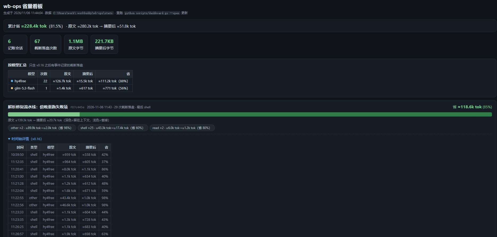

# wb-ops

[](.codebuddy-plugin/plugin.json)
[](#-development)
[](#-installation)
[](#-installation)

**[简体中文](README.md) · [English](README.en.md)**

**wb-ops** is a **context governance plugin** for [WorkBuddy](https://www.workbuddy.cn): an in-process Mod middleware that deterministically compresses tool outputs *before* they enter the model's context, spilling the full original text to disk for later retrieval. One goal: **make every token that enters the context carry high-value information**.

> In a long session, tool outputs often consume 60%+ of the context — mostly intermediate noise nobody reads again. wb-ops compresses them into a *head + key lines + tail* summary, saves the complete original to a local file, and hands the model a retrieval path.

<div align="center">
  
  <p><sub>The savings dashboard: per-session, per-model, per-compression timelines — one glance in the browser</sub></p>
</div>

## ✨ Features

- **Deterministic interception, not prompt conventions** — runs as a WorkBuddy Mod (`tool.call` middleware); host-enforced, in-process, zero subprocesses; the model cannot "forget" to invoke it
- **8 high-frequency exits + wildcard fallback** — Bash / PowerShell / TaskOutput / Grep / Glob / Read / WebFetch / WebSearch, plus a generic fallback for any other tool (including MCP)
- **Errors are never compressed** — failed commands pass through intact, with a one-line actionable next-step hint (9 recognized error patterns)
- **Originals are never lost** — compressed content is spilled to `~/.workbuddy/wb-ops/spill/`; the marker line carries the path so the model can Read it back
- **Savings you can see** — every compression marker inlines `≈N tok → ≈M tok (P% saved)`; three views (in-session report tool, CLI report, browser dashboard) aggregated by tool type / session / model
- **Fail-open by design** — unknown shapes, any exception, non-zero exit codes all pass through untouched; worst case = the plugin behaves as if absent
- **Zero dependencies** — pure TypeScript core; 109 offline unit tests, all green

## 🚀 Installation

### Option 1: one sentence to the AI (recommended)

Paste this into a WorkBuddy conversation and the AI does the rest (clone → install → verify):

> Install the wb-ops plugin for me: clone https://github.com/njuptlzf/wb-ops to ~/work/wb-ops, run `node scripts/install-gui.mjs`, confirm `wb-ops@wb-ops-local` shows enabled via `plugin list`, then tell me how to activate it.

### Option 2: command line

```bash
git clone https://github.com/njuptlzf/wb-ops ~/work/wb-ops
node ~/work/wb-ops/scripts/install-gui.mjs
node "<WorkBuddy>/resources/app.asar.unpacked/cli/dist/codebuddy-lite-wb.mjs" plugin list
```

### Activation

The middleware bootstraps at **runtime startup** — open a **new conversation** after installing (`/reload-plugins` does not re-bootstrap mods).

## 📊 Seeing your savings

| What | How |
|---|---|
| Per-compression savings | Nothing to do — every `[wb-ops]` marker line inlines `≈N tok → ≈M tok (P% saved)` |
| Machine-wide totals by tool type | Say "show the wb-ops report" in a session (`mcp__wb_ops__report`), or run `node hooks/report.mjs` |
| Per-session / per-model savings + timelines | `node scripts/dashboard.mjs --open` (static snapshot), or `--serve` for a live local view that re-reads ledgers on refresh |

The dashboard is a self-contained static HTML (zero dependencies). Data lives in `~/.workbuddy/wb-ops/stats/`; accounting is on by default (`WB_OPS_STATS=0` to disable).

## ⚙️ Configuration

All via environment variables; sensible defaults:

| Variable | Default | Purpose |
|---|---|---|
| `WB_OPS` | on | `0` disables everything |
| `WB_OPS_BUDGET` | 4500 | Compressed-output byte budget |
| `WB_OPS_STATS` | on | Accounting & reports; `0` disables (inline marker numbers unaffected) |
| `WB_OPS_HINTS` | on | One-line next-step hints on shell failures |
| `WB_OPS_GUARD` | on | Context watermark guard (≥85% notice) & compaction retention note |
| `WB_OPS_GUARD_PCT` | 85 | Watermark threshold (%) |
| `WB_OPS_FALLBACK` | on | Wildcard fallback compression |
| `WB_OPS_DEADLINE_MS` | 100 | Soft timeout; on expiry the original passes through |

## ⚠️ Known limitations

- **Host spill threshold caps the benefit** — outputs over ≈8KB are spilled by the host itself (`persisted-output`), so wb-ops only compresses within the [4.5KB, 8KB) band plus tools the host doesn't spill
- **Tokens are estimates** — same formula as the host (`ceil(CJK/1.8)+ceil(rest/4)`); display only, decisions are byte-based
- **No backfill for historical ledgers** — per-model and per-event data start at v0.16; older ledgers show an honest empty state
- **Retention note depends on LLM summarization** — absent when the host takes the engineering-compaction shortcut (expected)
- **Some GUI paths unverified** — plugin-panel click-to-enable after GUI restart is not yet verified on real hardware (mod loading itself is), see [docs/VERIFICATION.md](docs/VERIFICATION.md)

## 🧑‍💻 Development

```bash
node --test test/register.test.ts test/dashboard.test.mjs   # 109 tests, all green
bash test/run-acceptance.sh <uuid> "acceptance" WB_OPS_GUARD_PCT=10
```

## 📚 Documentation

| Doc | Contents |
|---|---|
| [docs/ALGORITHMS.md](docs/ALGORITHMS.md) | Algorithms: per-exit savings algorithms, thresholds, token estimation rules |
| [docs/BENCHMARK.md](docs/BENCHMARK.md) | Fidelity benchmark: does compression distort context? Method and results (`node test/benchmark.mjs`) |
| [docs/DESIGN.md](docs/DESIGN.md) | Design rationale: why a Mod, hot-path discipline, accounting triple, diagnostics, host shape findings |
| [docs/ROADMAP.md](docs/ROADMAP.md) | Roadmap: public backlog, prioritized P0/P1/P2, with acceptance criteria |
| [docs/VERIFICATION.md](docs/VERIFICATION.md) | Verification report: real-machine acceptance, raw data, reproduction commands |
| [CHANGELOG.md](CHANGELOG.md) | Release notes |

## 🙏 Acknowledgments

Design principles inherited from [T-Auto/dsh-ops](https://github.com/T-Auto/dsh-ops) (bounded output, retrievable spill, error-loop containment); the implementation is WorkBuddy-specific, zero-dependency pure TypeScript.
