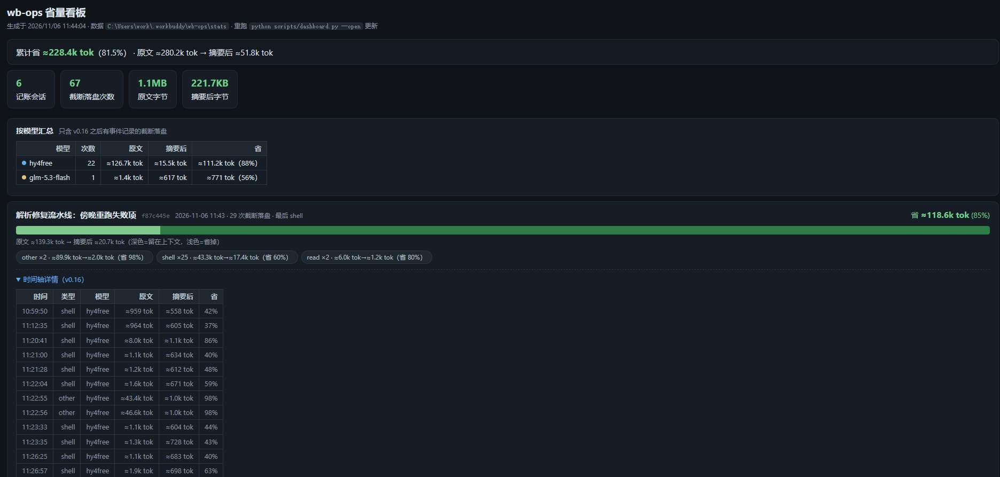

# wb-ops

[](.codebuddy-plugin/plugin.json)
[](#-开发与测试)
[](#-安装)
[](#-安装)

**[简体中文](README.md) · [English](README.en.md)**

**wb-ops** 是 [WorkBuddy](https://www.workbuddy.cn) 的**上下文治理插件**：以进程内 Mod 中间件拦截工具输出，在进入模型上下文之前做确定性压缩，原文落盘可回查。目标只有一个——**让进入上下文的每一份 token 都携带高价值信息**。

> 一次长会话下来，工具输出往往占掉上下文的 60% 以上，其中大部分是没人再看的中间过程。wb-ops 把它们压成"头 + 关键行 + 尾"的摘要，完整原文存到本地文件，需要时随时取回。

<div align="center">
  
  <p><sub>省量看板：每个会话省了多少、按哪个模型省的、每次压缩的时间轴，浏览器打开一目了然</sub></p>
</div>

## ✨ 特性与优势

- **确定性拦截，不是提示词约定**——以 WorkBuddy Mod（`tool.call` 中间件）运行，宿主强制执行、进程内零子进程，模型无法"忘记"调用它
- **覆盖 8 个高频出口 + 通配兜底**——Bash / PowerShell / TaskOutput / Grep / Glob / Read / WebFetch / WebSearch；其余任意工具（含 MCP）由通配兜底接管
- **错误输出永不压缩**——命令失败时完整透传现场，并附一行可执行的下一步提示（9 类常见错误模式识别）
- **原文永不丢失**——被压缩内容落盘 `~/.workbuddy/wb-ops/spill/`，摘要里附带路径，模型需要细节时自己 Read 回查
- **省了多少，看得见**——每次压缩的标记行内联 `≈N tok → ≈M tok（省 P%）`；会话内报表工具、终端报表、浏览器看板三种视图，按工具类型 / 会话 / 模型多维度汇总
- **fail-open 安全兜底**——未知形状、任何异常、非零退出码一律原样放行；插件坏掉的最坏情况 = 当它不存在
- **零依赖**——纯 TypeScript 核心 + 零依赖 Node 脚本，离线单测 109 项全绿

## 🚀 安装

### 方式一：跟 AI 说一句话（推荐）

把下面这句直接发给 WorkBuddy 对话里的 AI，剩下的它来做（克隆 → 安装 → 校验 → 告知生效方式）：

> 帮我安装 wb-ops 插件：克隆 https://github.com/njuptlzf/wb-ops 到 ~/work/wb-ops，然后运行 `node scripts/install-gui.mjs` 完成安装，再用 `plugin list` 确认 `wb-ops@wb-ops-local` 显示 enabled，最后告诉我怎么让它生效。

升级与卸载也是一句话：

```text
升级：wb-ops 出新版了：在 ~/work/wb-ops 里 git pull 后重新运行 node scripts/install-gui.mjs，确认 plugin list 版本号已更新。
卸载：卸载 wb-ops 插件：运行 node scripts/install-gui.mjs --uninstall（只摘它自己，不动其他插件）。
```

### 方式二：命令行（手动）

```bash
# 1. 克隆
git clone https://github.com/njuptlzf/wb-ops ~/work/wb-ops

# 2. 安装（写齐宿主加载必需的三处注册：市场清单 + installed_plugins + enabledPlugins）
node ~/work/wb-ops/scripts/install-gui.mjs

# 3. 自检（应显示 wb-ops@wb-ops-local · Status: enabled）
node "<WorkBuddy>/resources/app.asar.unpacked/cli/dist/codebuddy-lite-wb.mjs" plugin list
```

### 生效方式

插件的中间件在**运行时启动时**引导——安装后**新开一个对话**即生效（`/reload-plugins` 不会重新引导）。

## 📊 查看省了多少

| 想看 | 怎么做 |
|---|---|
| 单次压缩省了多少 | 不用做：每次压缩的 `[wb-ops]` 标记行自带 `原文 …≈N tok → ≈M tok（省 P%）` |
| 本机累计（按工具类型细分） | 会话里说"调一下 wb-ops 报表"（`mcp__wb_ops__report`），或终端跑 `node hooks/report.mjs` |
| 每个会话 / 每个模型省了多少 + 时间轴 | `node scripts/dashboard.mjs --open` 生成并打开浏览器看板；或 `--serve` 起本地服务，刷新即最新 |

看板（即上方截图）零依赖、纯静态自包含：`node scripts/dashboard.mjs` 生成 HTML 快照，`--serve [端口]`（默认 8765）则每次刷新重读账本。数据来自 `~/.workbuddy/wb-ops/stats/`，记账默认开启（`WB_OPS_STATS=0` 可关）。

装完想确认真的在工作？新开一个对话，一句话验证：

> 运行 `seq -f "row-%04g" 1 1200`，告诉我输出里有没有 `[wb-ops]` 标记和落盘路径。

预期：输出被压成 头+关键行+尾，附 `原文 NNKB → 落盘 …/spill/<会话>/…txt`。

## 📖 压缩策略一览

| 工具 | 策略 |
|---|---|
| Bash / PowerShell / TaskOutput | 失败**完整透传** + 一行下一步提示；超预算压成 头+关键行+尾 |
| Grep / Glob | 裁条目保计数，保持宿主原生数组形态 |
| Read | 按文件类型分档：数据类 >200 行才裁，**源码 <1500 行一律不裁**；空洞给 offset/limit 指路 |
| WebFetch / WebSearch | 标题/链接/加粗行当骨架捞回，正文省略 |
| 其余工具（含 MCP） | 通配兜底通用压缩，失败同样完整透传，可单独关闭 |

所有档位共用：预算按 UTF-8 字节计、原文 >8MB 透传、fail-open。完整算法见 [docs/ALGORITHMS.md](docs/ALGORITHMS.md)；压缩后是否失真见 [docs/BENCHMARK.md](docs/BENCHMARK.md)。

## ⚙️ 配置

全部通过环境变量控制（默认无需配置）：

| 变量 | 默认 | 说明 |
|---|---|---|
| `WB_OPS` | 开 | `0` 全局关闭 |
| `WB_OPS_BUDGET` | 4500 | 压缩后文本字节上限 |
| `WB_OPS_STATS` | 开 | 省量记账与报表；`0` 关闭（标记行内联数字不受影响） |
| `WB_OPS_HINTS` | 开 | shell 失败现场的一行提示；`0` 关闭 |
| `WB_OPS_GUARD` | 开 | 上下文水位守卫（≥85% 提醒）与压缩保留指示；`0` 关闭 |
| `WB_OPS_GUARD_PCT` | 85 | 水位提醒阈值（百分比） |
| `WB_OPS_FALLBACK` | 开 | 通配兜底；`0` 只保留白名单出口 |
| `WB_OPS_DEADLINE_MS` | 100 | 压缩软超时，超时放弃、透传原文 |

## ⚠️ 已知限制

如实说，当前版本的边界：

- **宿主落盘阈值是收益天花板**——工具输出超过 ≈8KB 时宿主会先自行落盘（`persisted-output`），wb-ops 看不到原文，因此实际压缩只发生在 [4.5KB, 8KB) 的区间 + 宿主未落盘的工具
- **token 是估算值**——公式与宿主一致（`ceil(中文/1.8)+ceil(其余/4)`），用于展示；压缩决策按字节
- **历史数据无法回填**——模型维度与逐次时间轴自 v0.16 起记录，旧账本在看板上如实显示空态
- **压缩保留指示依赖 LLM 摘要**——宿主走工程压缩（跳过 LLM 摘要）时，保留指示不出现在摘要正文（预期行为）
- **部分 GUI 路径待验证**——GUI 重启后插件面板的识别与点击启用流程尚未真机验证（mod 加载本身已验证），见 [docs/VERIFICATION.md](docs/VERIFICATION.md)

## 🧑‍💻 开发与测试

```bash
node --test test/register.test.ts test/dashboard.test.mjs   # 109 项，全绿
bash test/run-acceptance.sh <合法UUID> "验收" WB_OPS_GUARD_PCT=10   # 真机验收触发器
```

沙箱纪律：mods 内禁止 `node:require/process/global`（引擎会当场拒绝整个 mod）；所有宿主能力走 `$` 命名空间。

## 📚 文档

| 文档 | 内容 |
|---|---|
| [docs/ALGORITHMS.md](docs/ALGORITHMS.md) | 算法说明：各出口的省量算法、阈值与 token 估算口径 |
| [docs/BENCHMARK.md](docs/BENCHMARK.md) | 保真度 benchmark：压缩后上下文是否失真？方法论与结果（`node test/benchmark.mjs` 可复跑，兼作回归门禁） |
| [docs/DESIGN.md](docs/DESIGN.md) | 设计文档：为什么是 Mod、热路径性能纪律、记账三元组、诊断通道、宿主形状实测 |
| [docs/ROADMAP.md](docs/ROADMAP.md) | 路线图：公开待办清单（P0/P1/P2 分级，含验收方式） |
| [docs/VERIFICATION.md](docs/VERIFICATION.md) | 验证报告：真机验收流程、原始数据、复现命令、已验证/未验证清单 |
| [CHANGELOG.md](CHANGELOG.md) | 版本变更记录 |

## 🙏 致谢

设计原则继承 [T-Auto/dsh-ops](https://github.com/T-Auto/dsh-ops)（有界输出、可回查的 spill、遏制报错循环）；代码为 WorkBuddy 专用实现，零依赖纯 TS 核心。
